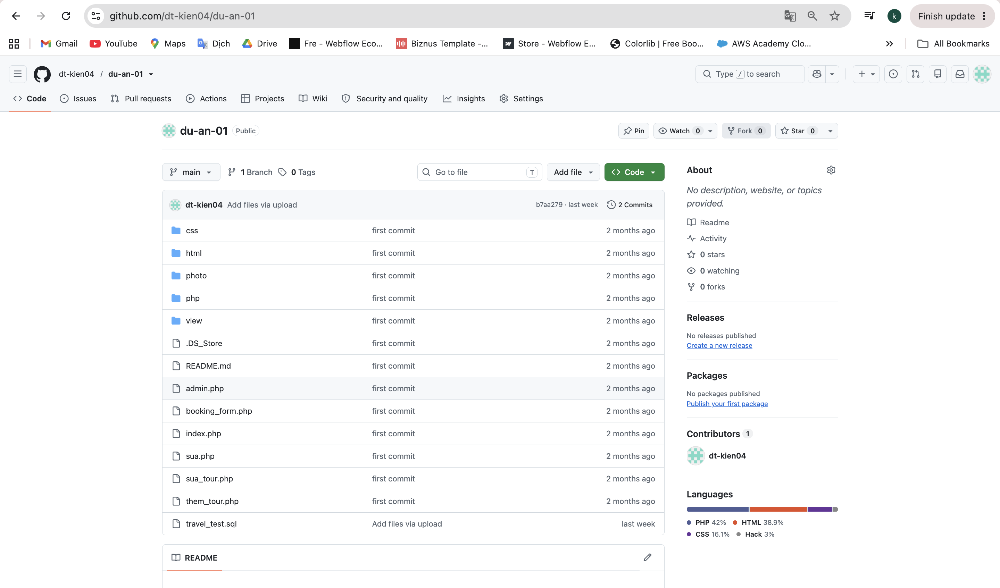

Tài khoản AWS đã kích hoạt gói 100 USD Credits và chọn Region Asia Pacific (Singapore) ap-southeast-1.

Mã nguồn ứng dụng Web Travel đã được chuẩn hóa từ XAMPP và đẩy lên kho lưu trữ GitHub công khai (https://github.com) kèm tệp cơ sở dữ liệu travel_test.sql.

Máy tính cá nhân (MacBook Pro) cài đặt Visual Studio Code hoặc Terminal hỗ trợ kết nối SSH.