#### Create a DB Subnet Group (travel-data-subnet-group) encompassing both Private Subnets.

Launch the travel-database DB instance (MySQL, db.t4g.micro, 20 GiB gp2 storage), disable public accessibility (Public access = No), attach TL-Database, and specify travel_test as the initial database name.

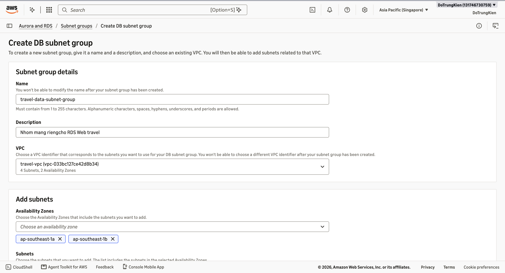
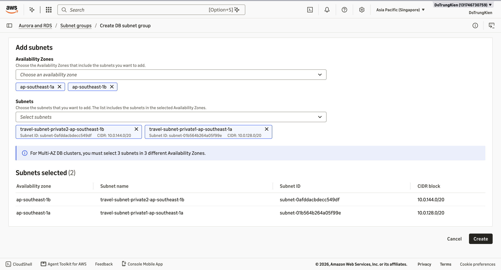
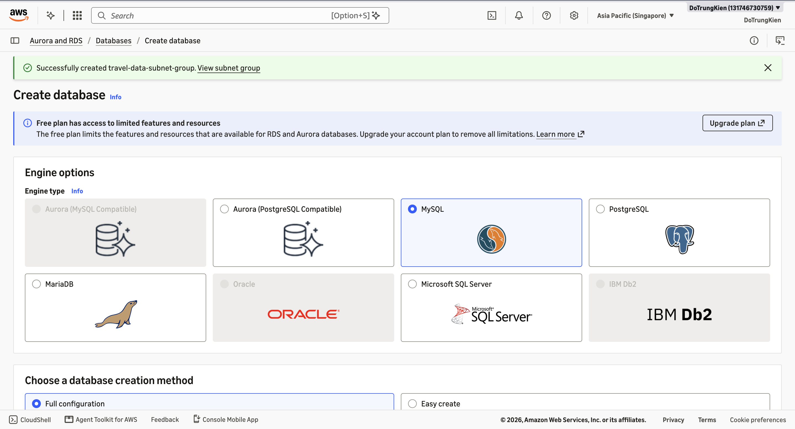
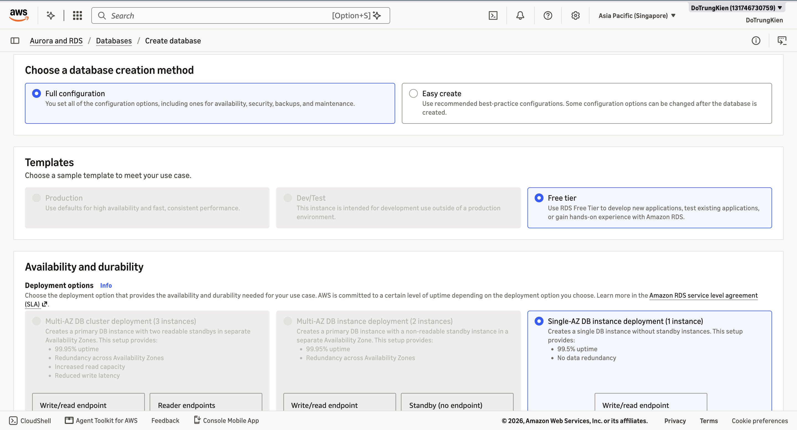
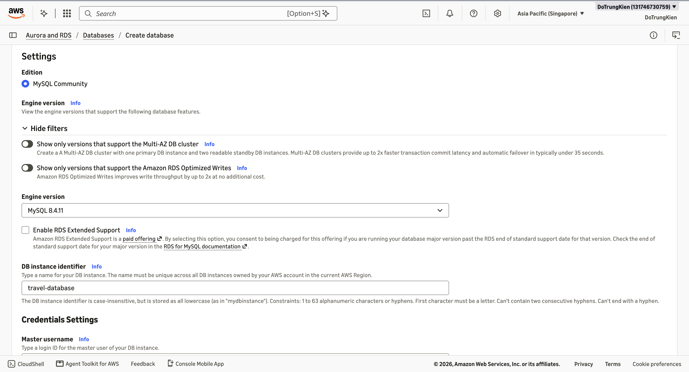
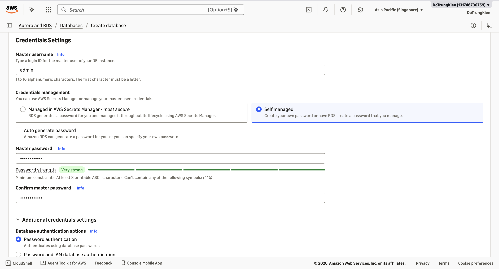
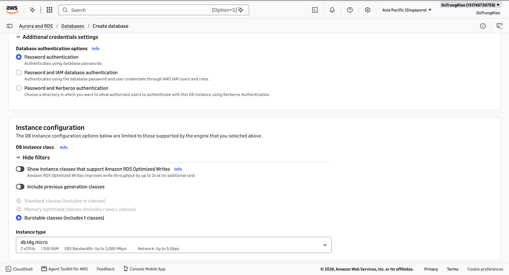
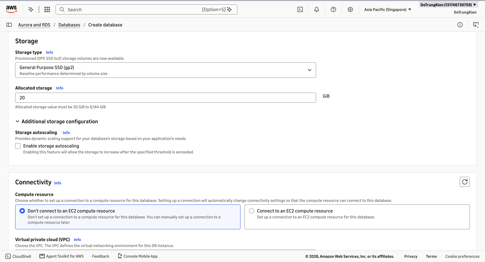
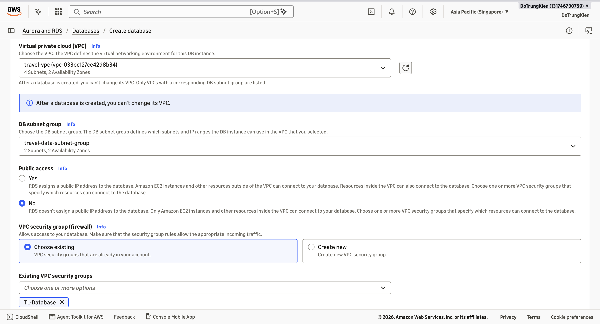
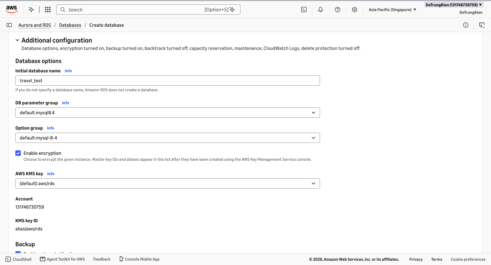
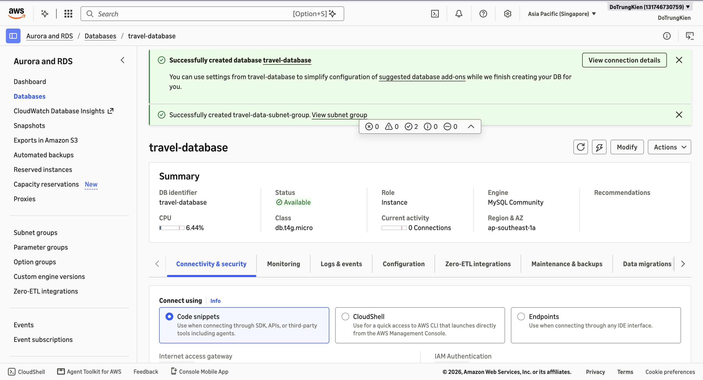
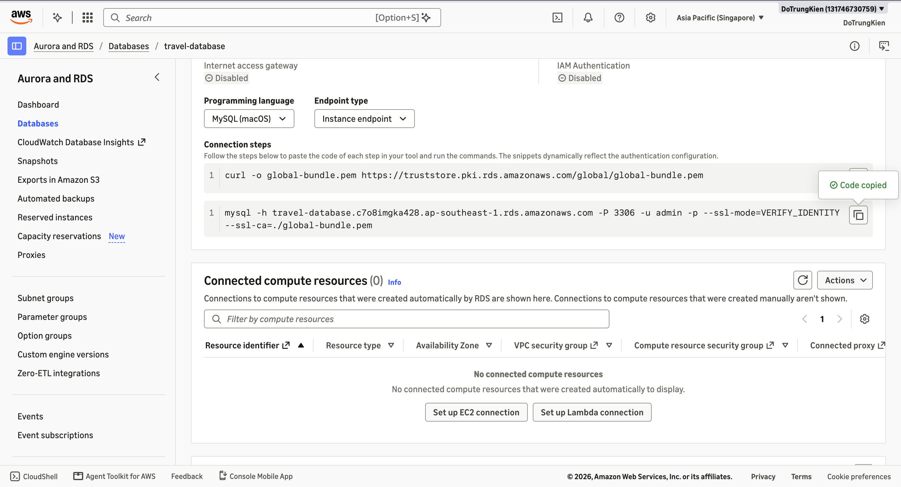
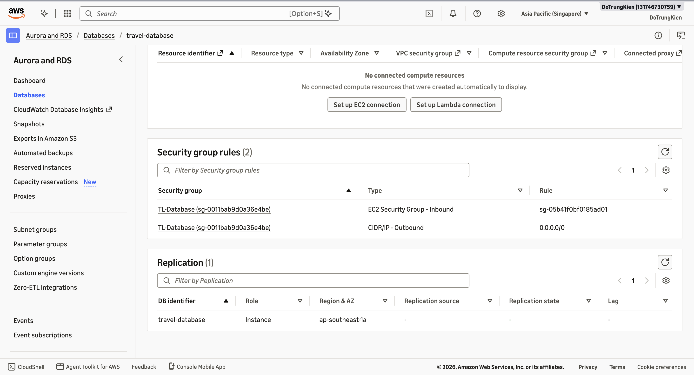
