#### Tạo DB Subnet Group (travel-data-subnet-group) gồm 2 Private Subnets.

Khởi tạo DB instance travel-database (MySQL, cấu hình db.t4g.micro, ổ cứng 20 GiB gp2), tắt truy cập công cộng (Public access = No), gắn tường lửa TL-Database và đặt tên database khởi tạo là travel_test.

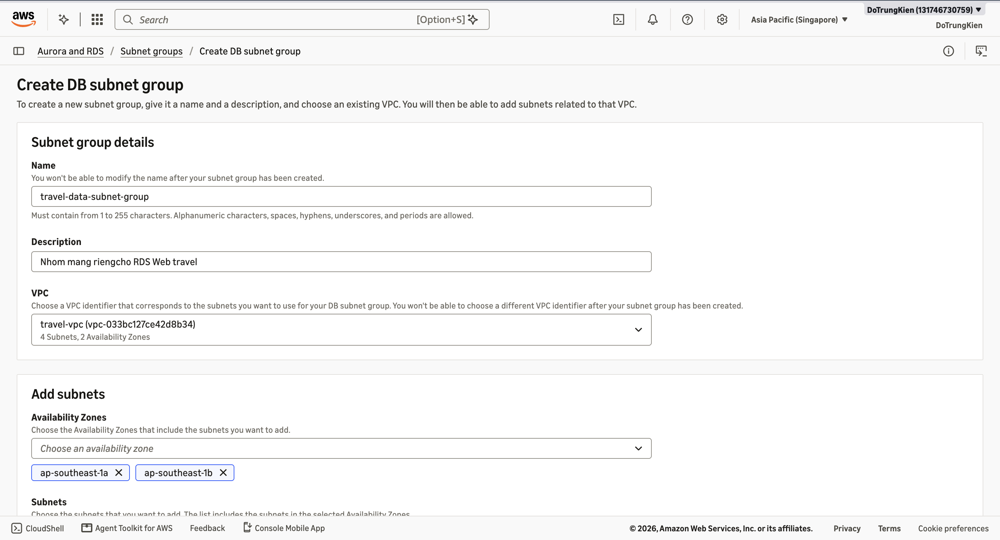
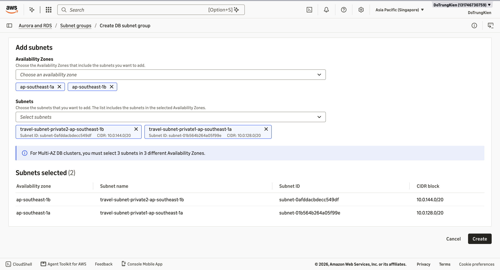
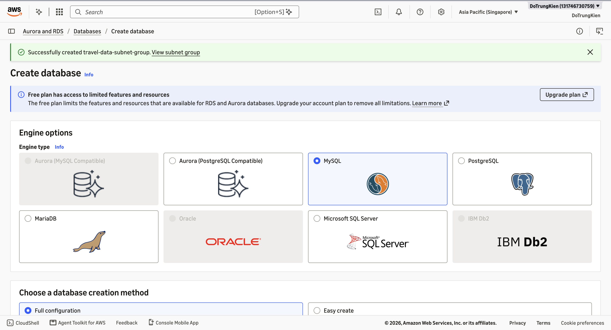
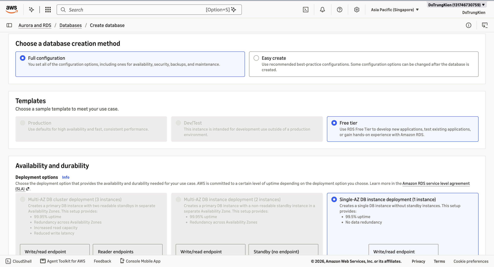
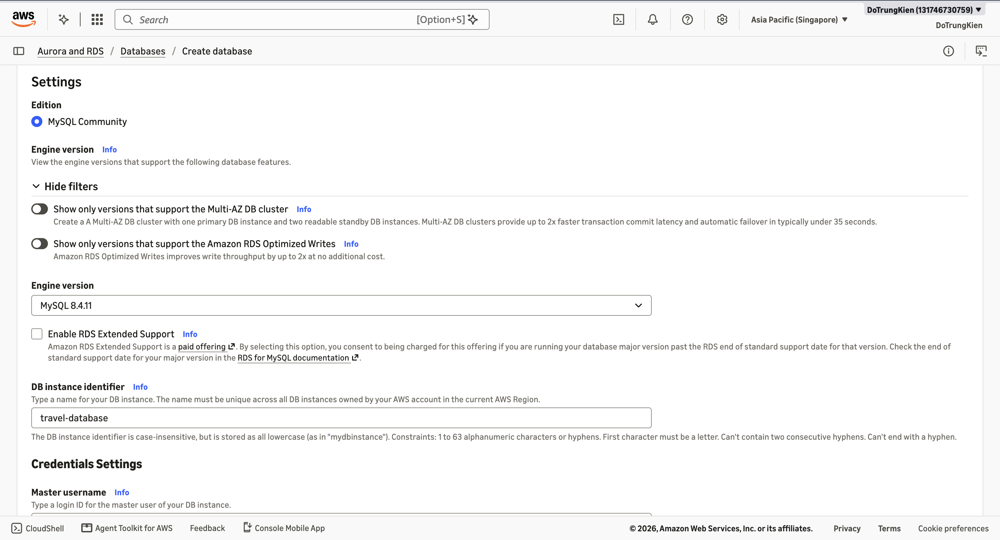
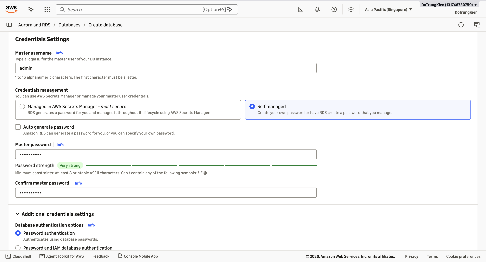
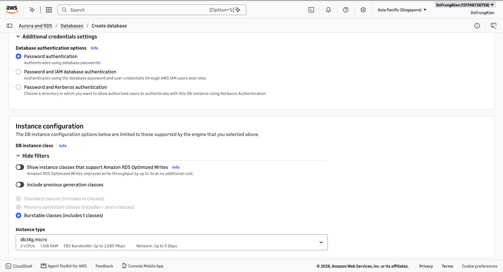
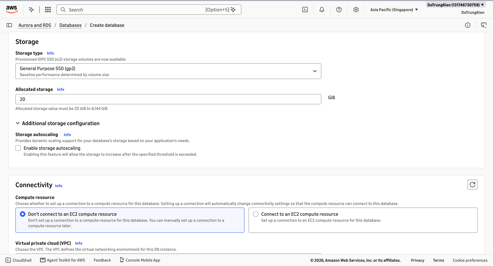
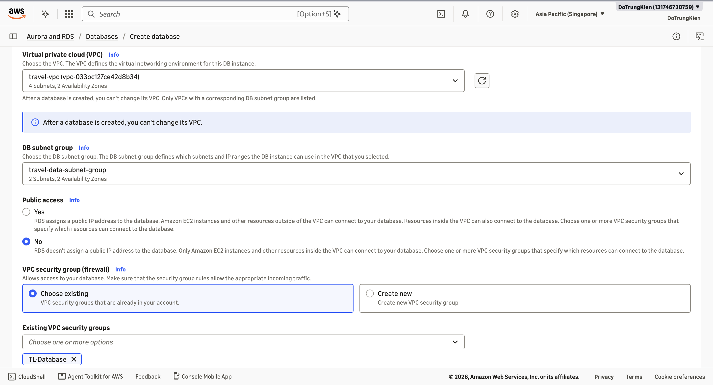
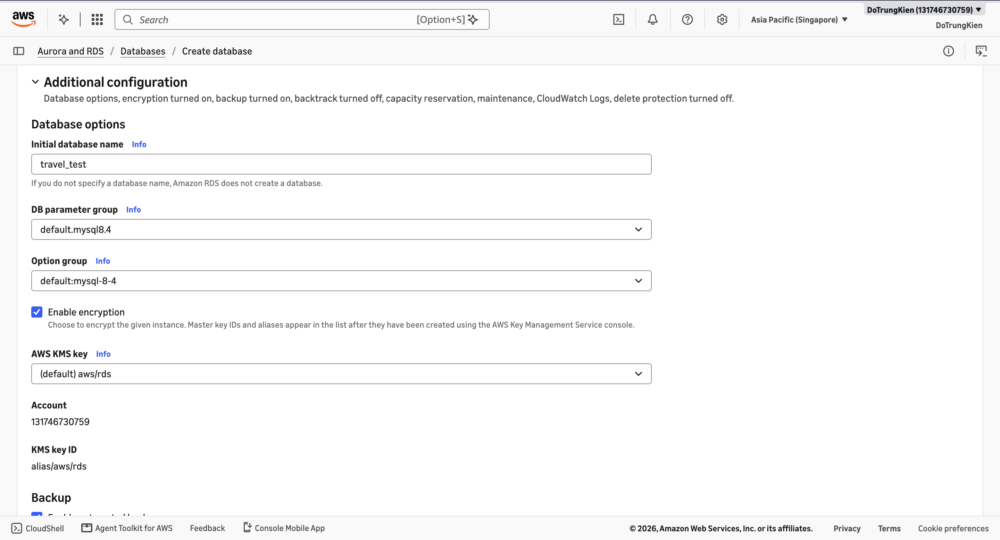
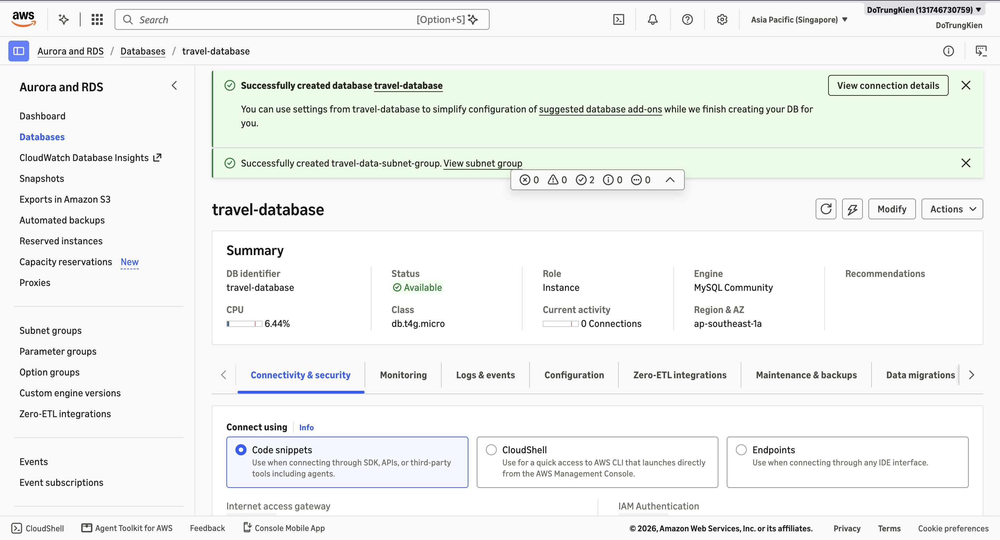
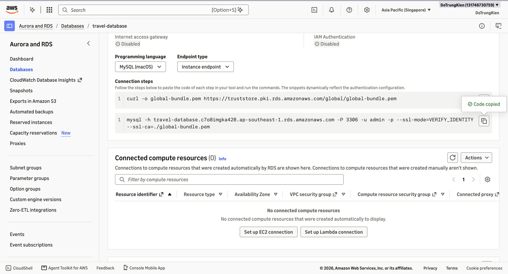
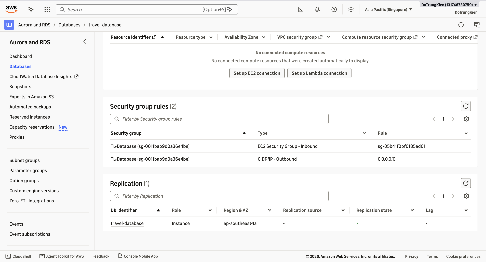
