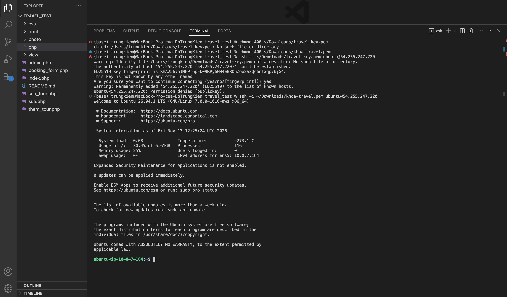

Import travel_test.sql into the travel-database Endpoint using the mysql CLI.

Update the database connection parameters (Endpoint, admin user, password, and travel_test database) inside /var/www/html/php/ket_noi.php.

