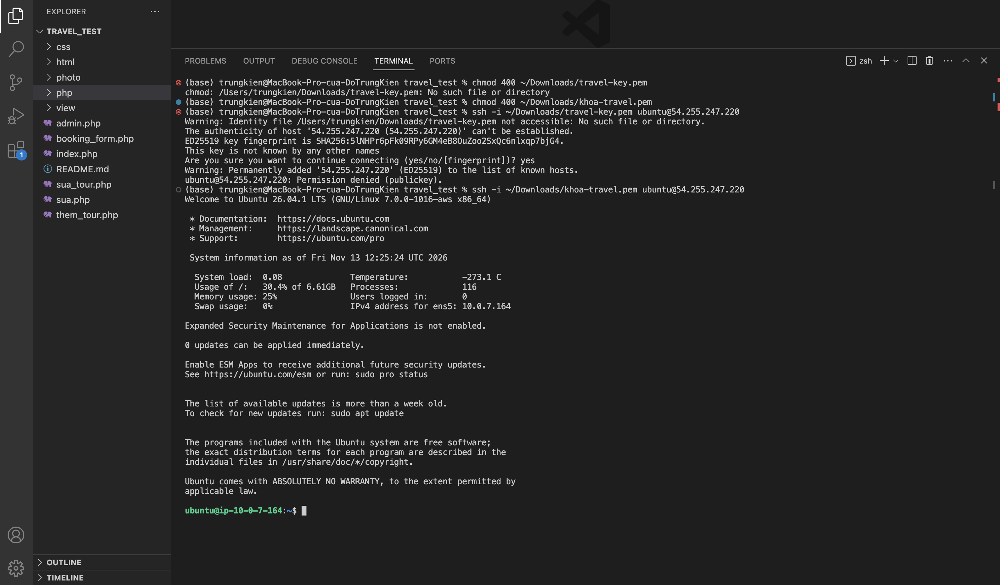

Nạp tệp travel_test.sql lên Endpoint của travel-database qua dòng lệnh mysql.

Cập nhật thông tin kết nối (Endpoint, user admin, mật khẩu và tên database travel_test) trong tệp /var/www/html/php/ket_noi.php.

